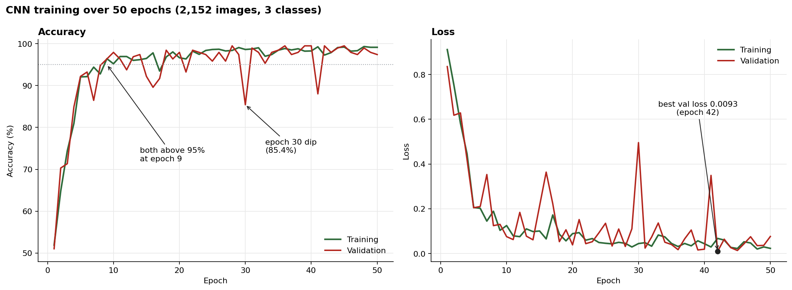
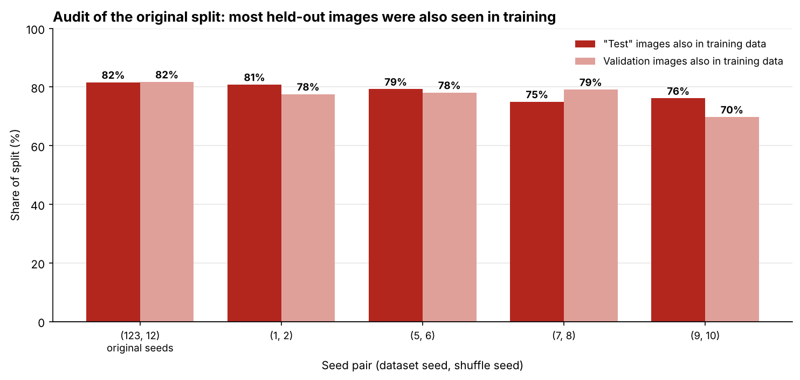

# Potato Leaf Disease Detection with a CNN

A convolutional neural network, built from scratch in **TensorFlow/Keras**, that classifies potato leaf photos as **Early blight**, **Late blight** or **Healthy**. The goal: let a farmer catch crop disease early from a simple photo.


---

## Key results

> **Read this first:** the 96.9% test accuracy below comes from the original notebook's split. An audit that rebuilds that exact pipeline (see [Audit](#audit-was-the-original-test-set-really-unseen)) shows that roughly **four out of five "held-out" images were also in the training set**, so the number is optimistic. The repo includes a leak-free pipeline; re-train on your copy of the images to get an honest score.

| Metric | Result |
|---|---|
| Dataset | **2,152** leaf images, **3** classes, 256x256 RGB |
| Split (batches of 32) | 54 train / 6 validation / 8 test batches (about 1,728 / 192 / 256 images) |
| Model size | **183,747** parameters (about 718 KB) |
| **Test accuracy (original split)** | **96.875%** (248 of 256 images), test loss 0.1037, **optimistic** (see audit) |
| **Split audit** | **78.6%** of "test" images (81.6% with the original seeds) were also in the training set |
| Best validation accuracy | 99.48% (epoch 28, 36, 39, 40, 42, 45) |
| Time to 95% (train and validation) | **epoch 9** |
| Final epoch | train 99.1%, validation 97.4% |
| Training time | about 49 minutes on CPU (58 s per epoch, 50 epochs) |
| Sample of 9 unseen leaves | **9 of 9 correct**, confidence 92.1% to 100% |



### What the results say

1. **A small network is enough.** Six conv + pooling blocks and one dense layer reach about 97% test accuracy. Plant-disease photos on plain backgrounds are a relatively easy visual task.
2. **It learns fast and fits healthily.** Both curves pass 95% by epoch 9. Over the last 10 epochs training accuracy averages 98.7% vs. 97.3% for validation, a gap of only about 1.3 points.
3. **Validation is noisy.** Validation loss spikes at epochs 7, 16, 30 and 41 (up to 0.50) and validation accuracy dips to **85.4%** at epoch 30, while training stays smooth. The validation set is just 192 images, so a few mistakes move the score by several points.
4. **The last epoch was not the best.** The lowest validation loss (0.0093) was at **epoch 42**, but the original run kept the epoch-50 weights (validation loss 0.076). Checkpointing and early stopping are now built in.
5. **The healthy class is the one to watch.** In the 9-image sample, the healthy leaf had the lowest confidence (92.1%), and in the one batch of labels inspected, only 1 of 32 images was healthy. Healthy leaves are a small minority, so per-class metrics matter.


### Audit: was the original test set really unseen?

The original notebook made its splits with `take()`/`skip()` on a dataset that reshuffles on every pass, then cached each split separately. To measure what that does, `scripts/audit_split_leakage.py` re-creates the pipeline on **synthetic images whose pixels encode a unique ID** (same structure as the real data: 1,000 / 1,000 / 152 files, batch size 32, 54/6/8 batches), runs it in the order `model.fit()` and `model.evaluate()` would, and checks which images appear in more than one split.



- With the original seeds (123 and 12), **81.6% of the 256 test images and 81.8% of the 192 validation images were also in the training set**. Across 5 seed pairs the mean is **78.6%** for test.
- The effect comes from the pipeline's structure, so it should apply to the real run too, but the exact overlap in the original run is unknown because the audit uses synthetic images, not the real files.
- Consequence: the validation curve (and its 99.5% peak) and the 96.9% test score mostly measure how well the model remembers images it trained on. The fix is to split **file paths once, before any shuffling**, which is what `src/potato_cnn.py` does.

---

## What I did

| Step | Description |
|---|---|
| **1. Load data** | `image_dataset_from_directory` on a folder-per-class dataset: 256x256 images, batch size 32, shuffled with a fixed seed. |
| **2. Explore** | Inspected image batches and labels to understand the three classes. |
| **3. Split** | 80/10/10 train/validation/test. |
| **4. Pipeline** | Cached, shuffled and prefetched the data for speed; added on-the-fly augmentation (random flips, rotation up to 20%) for training only. |
| **5. Model** | Resize and rescale layers inside the model, then 6 Conv2D(3x3) + MaxPooling blocks (32, then 64 filters), Flatten, Dense(64), Softmax(3). |
| **6. Train** | Adam optimizer, sparse categorical cross-entropy, 50 epochs, tracking accuracy and loss. |
| **7. Evaluate** | Test-set evaluation, training curves, and a 3x3 grid of predictions with confidence scores. |
| **8. Package** | Rebuilt the pipeline as a tested module (`src/potato_cnn.py`), a one-command trainer, a narrated notebook and charts. |

---

## Issues found in the original pipeline, and fixes

| Issue | Why it matters | Fix |
|---|---|---|
| Splits were made with `take()`/`skip()` on a dataset that **reshuffles each pass**, then cached separately | Images land in more than one split. **Measured with the audit above: about 79% of "test" images were also in training.** This inflates validation and test accuracy. | Split **file paths once**, stratified by class, with fixed seeds; tests assert the sets are disjoint |
| Only overall accuracy reported | A small healthy class can hide weak per-class results | Per-class precision/recall/F1 and a confusion matrix are saved |
| `predict(img)` read a global `images[i]` instead of its argument | Would give wrong answers on a new photo | Uses the image it is given (path or array) |
| Fixed 50 epochs, last weights kept, model not saved | Best epoch was 42; about 49 minutes of CPU; nothing reusable | `EarlyStopping` + best-model checkpoint, saved as `best_model.keras` |

---

## Project structure

```
.
├── README.md
├── requirements.txt
├── train.py                        # python train.py --data-dir <dataset> : leak-free split, early stopping, metrics
├── scripts/audit_split_leakage.py  # reproduces the split-overlap measurement (no real data needed)
├── src/
│   ├── potato_cnn.py               # data split, model, training, evaluation, predict
│   └── potato_viz.py               # charts from the captured training log
├── notebooks/
│   └── Potato_Disease_CNN_Analysis.ipynb   # narrated walkthrough with results and insights
├── data/training_history.csv       # 50-epoch log captured from the original run
├── results/                        # original test metrics, model summary, split_leakage_audit.json
├── figures/                        # training curves, architecture, sample predictions, leakage audit
├── tests/test_pipeline.py          # smoke tests (synthetic images)
└── original/model_original.ipynb   # the starting notebook, untouched
```

## How to run

```bash
pip install -r requirements.txt
python train.py --data-dir path/to/PlantVillage --epochs 50
python tests/test_pipeline.py
python scripts/audit_split_leakage.py     # reproduces the leakage audit (about 1 minute)
jupyter notebook notebooks/Potato_Disease_CNN_Analysis.ipynb
```

`train.py` writes `history.csv`, `metrics.json` (accuracy plus per-class metrics), `confusion_matrix.csv` and `best_model.keras` to `results/new_run/`. The notebook runs without the images because it reads the captured training log.

## Data

The notebook loads a folder-per-class potato leaf dataset with the classes `Potato___Early_blight`, `Potato___Late_blight` and `Potato___healthy` (2,152 images). This appears to be the **PlantVillage potato subset**; the images themselves are not included in this repository. Download them separately and point `--data-dir` at the folder.

## Limitations

- **The original run's validation and test scores are inflated by split overlap** (audit above, run on synthetic images). The new pipeline removes the overlap, but it has not yet been trained on the real images, so no leak-free accuracy is reported here.
- **Single run, single split**: no repeated trials or confidence intervals; the 192-image validation set is small and noisy.
- **No per-class metrics were recorded**, and class counts were not printed; the class-imbalance point is inferred from one label batch and the dataset's public composition.
- Leaves are photographed against plain backgrounds, so **real field photos may be harder**.
- The improved module (`src/potato_cnn.py`) was tested on synthetic images only; it has not yet been trained on the real dataset.

## Next steps

- Re-train with the leak-free split and report a confusion matrix and per-class F1.
- Compare against transfer learning (e.g. MobileNetV2) and class-weighted loss.
- Add **Grad-CAM** heat maps to show where the model looks on each leaf.
- Export to TensorFlow Lite or a small API to power a mobile app.

## Tech stack

Python · TensorFlow/Keras · scikit-learn · pandas · matplotlib · Jupyter

## Credits

Dataset: PlantVillage potato leaf images. Model and analysis by Kashaf Malik.
