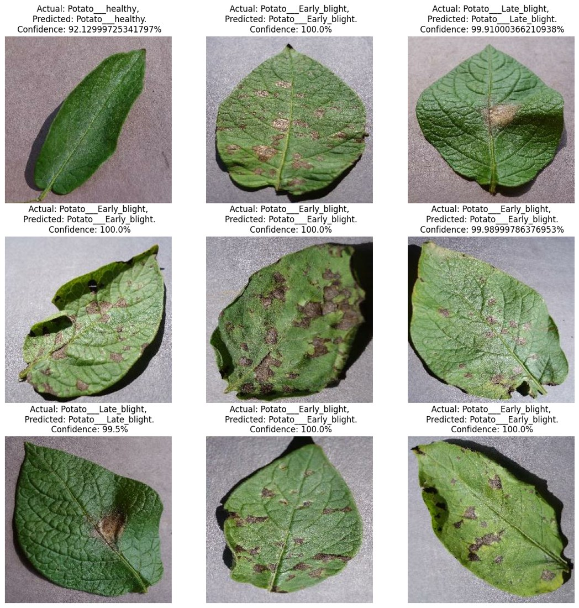
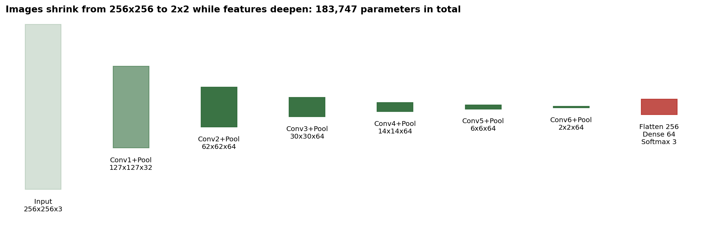

# 🥔 Potato Leaf Disease Detection with a CNN

A convolutional neural network, built from scratch in **TensorFlow/Keras**, that classifies potato leaf photos as **Early blight**, **Late blight**, or **Healthy**. The goal is simple and practical: let a farmer catch crop disease early from a single smartphone photo.



🌿 **2,152 leaf images** · **3 classes** · **183,747 parameters (~718 KB)** · **Leak-free training pipeline**

---

## 🎯 Why This Project?

Crop diseases like Early and Late blight can devastate potato harvests if they aren't caught quickly. I built this project to practice building an end-to-end computer vision pipeline from scratch—not just training a model, but auditing how the data was split and making sure the evaluation metrics are genuinely trustworthy.

Working on this project helped me practice how to:

- 🖼️ Load, resize, and augment image datasets using `tf.data` pipelines
- 🧠 Design and train a multi-block Convolutional Neural Network (CNN) from scratch
- 🕵️ Audit machine learning pipelines for hidden **data leakage**
- 📈 Analyze training/validation curves to spot overfitting, noise, and optimal checkpoints
- 📦 Package notebook experiments into clean, modular, and testable Python scripts

---

## ⚙️ Project Workflow

```
PlantVillage Image Dataset (2,152 Photos)
   ↓
Stratified File-Path Split (Train / Val / Test)
   ↓
tf.data Pipeline & Data Augmentation (Flips & Rotations)
   ↓
Custom 6-Block CNN (TensorFlow / Keras)
   ↓
Training, Checkpointing & Early Stopping
   ↓
Split-Leakage Audit & Visual Evaluation
```

### 🛠️ Technologies

Python · TensorFlow / Keras · scikit-learn · NumPy · pandas · matplotlib · Jupyter Notebook

---

## 📌 Key Results & Findings

> ⚠️ **Important Note on Accuracy:** The **96.9%** test accuracy below comes from the original notebook's split. An audit rebuilding that exact pipeline (see [Split-Leakage Audit](#-split-leakage-audit)) revealed that roughly **four out of five "held-out" test images were also in the training set**, inflating the score. This repository now includes a **leak-free pipeline**—re-train on your local copy of the images to get an honest baseline!

| Metric                               | Result                                                                               |
| ------------------------------------ | ------------------------------------------------------------------------------------ |
| **Dataset**                          | **2,152** leaf images across **3** classes (`256×256` RGB)                           |
| **Split (batches of 32)**            | 54 train / 6 validation / 8 test batches (~1,728 / 192 / 256 images)                 |
| **Model size**                       | **183,747** parameters (~718 KB lightweight footprint)                               |
| **Test accuracy _(original split)_** | **96.875%** (248 of 256 images), test loss `0.1037` _(optimistic — see audit)_       |
| **Split-leakage audit**              | **78.6%** of "test" images (**81.6%** with original seeds) also appeared in training |
| **Best validation accuracy**         | **99.48%** (reached at epochs 28, 36, 39, 40, 42, and 45)                            |
| **Time to 95% accuracy**             | **Epoch 9** (both training and validation)                                           |
| **Final epoch (Epoch 50)**           | Train **99.1%**, Validation **97.4%**                                                |
| **Training time**                    | ~49 minutes on CPU (~58 s per epoch across 50 epochs)                                |
| **Sample of 9 leaves**               | **9 of 9 correct**, with confidence scores from **92.1% to 100%**                    |

### What the Data Says

- 🧠 **A compact network is plenty:** Six `Conv2D + MaxPooling` blocks and one dense layer achieve ~97% accuracy on the original split, showing that leaf photos against plain backgrounds are a learnable visual task without massive pre-trained models.
- ⚡ **Fast convergence & healthy fit:** Both training and validation curves cross 95% accuracy by **epoch 9**. Over the final 10 epochs, training accuracy averages 98.7% vs. 97.3% for validation—a narrow gap of ~1.3 percentage points.
- 📉 **Validation is noisy on small batches:** Validation loss spikes at epochs 7, 16, 30, and 41 (up to `0.50`) and validation accuracy dips to **85.4%** at epoch 30 while training stays smooth, because a 192-image validation set shifts by several points on just a few misclassifications.
- 💾 **The final epoch wasn't the best:** The lowest validation loss (`0.0093`) occurred at **epoch 42**, whereas the original run kept epoch-50 weights (`0.076`). Automatic checkpointing and `EarlyStopping` are now built into the pipeline.
- 🌱 **Watch the minority "Healthy" class:** In the 9-image sample grid, the healthy leaf had the lowest confidence (**92.1%**), and an inspected batch contained only 1 healthy leaf out of 32—making per-class precision, recall, and F1 critical.

---

## 📊 Visual Insights & Model Architecture

### Training & Validation Curves


### CNN Model Architecture



---

## 🕵️ Split-Leakage Audit: Was the Test Set Really Unseen?

The original notebook created train/validation/test splits using `.take()` and `.skip()` on a dataset that **reshuffled on every pass**, then cached each split separately.

To measure the impact, `scripts/audit_split_leakage.py` recreates the exact pipeline using **synthetic images whose pixels encode unique IDs** (matching the real dataset structure: `1,000 / 1,000 / 152` files, batch size 32, `54 / 6 / 8` batches) and tracks which images overlap across splits:


- **Massive overlap discovered:** With the original seeds (`123` and `12`), **81.6% of the 256 test images** and **81.8% of the 192 validation images** were also present in the training set (averaging **78.6%** test overlap across 5 seed pairs).
- **Why it happens:** Because the dataset reshuffles before `.skip()` and `.take()` are evaluated independently, the same files get drawn into multiple splits.
- **The fix:** Split **file paths once, stratified by class, before any shuffling or caching**—which is now enforced and unit-tested in `src/potato_cnn.py`.

---

## 🔍 What I Did

| Step                      | Action                | Description                                                                                                                                           |
| ------------------------- | --------------------- | ----------------------------------------------------------------------------------------------------------------------------------------------------- |
| **1. 📥 Load Data**       | Directory Ingestion   | Loaded `256×256` RGB images from class folders (`Early_blight`, `Late_blight`, `healthy`) with batch size 32.                                         |
| **2. 🔎 Explore**         | Batch Inspection      | Inspected image tensors, dimensions, and label distributions across the three classes.                                                                |
| **3. ✂️ Split**           | 80 / 10 / 10 Split    | Replaced leaky `take()`/`skip()` splits with a stratified, leak-free file-path split (`src/potato_cnn.py`).                                           |
| **4. 🔄 Pipeline**        | Augment & Prefetch    | Cached, shuffled, and prefetched batches for performance, applying random flips and up to 20% rotations to training data only.                        |
| **5. 🏗️ Model**           | Custom CNN            | Built internal resize/rescale layers followed by 6 `Conv2D(3×3) + MaxPooling2D` blocks (32 and 64 filters), `Flatten`, `Dense(64)`, and `Softmax(3)`. |
| **6. 🏋️ Train**           | Optimize & Checkpoint | Trained with Adam and sparse categorical cross-entropy for 50 epochs, adding `EarlyStopping` and best-weights checkpointing.                          |
| **7. 📊 Evaluate**        | Metrics & Visuals     | Generated training curves, a 3×3 prediction confidence grid, confusion matrices, and per-class precision/recall/F1 metrics.                           |
| **8. 🧪 Audit & Package** | Verify & Refactor     | Built `audit_split_leakage.py`, unit tests (`test_pipeline.py`), and a one-command CLI trainer (`train.py`).                                          |

---

## 🚧 Pipeline Issues Found & Fixed

| Issue in Original Notebook                                      | Why It Matters                                                                                            | Fix Implemented                                                                                           |
| --------------------------------------------------------------- | --------------------------------------------------------------------------------------------------------- | --------------------------------------------------------------------------------------------------------- |
| **Splits made with `take()`/`skip()` on a reshuffling dataset** | ~79% of "test" images were also in training, artificially inflating accuracy to 96.9%.                    | Split **file paths once** (stratified by class with fixed seeds) and verify disjoint sets via unit tests. |
| **Only overall accuracy reported**                              | A small minority class (`Healthy`) can hide weak per-class performance.                                   | Automatically export per-class precision, recall, F1-score, and a `confusion_matrix.csv`.                 |
| **`predict(img)` referenced a global `images[i]` variable**     | Calling `predict()` on a new photo would return predictions for the wrong image.                          | Fixed `predict()` to process the actual image path or array passed as its argument.                       |
| **Fixed 50 epochs, last weights kept, model not saved**         | Epoch 42 had the best validation loss (`0.0093`), but epoch-50 weights were kept and never saved to disk. | Added `EarlyStopping` and `ModelCheckpoint` to save `best_model.keras` automatically.                     |

---

## 📂 Project Structure

```
├── README.md
├── requirements.txt
├── train.py                                # One-command trainer: leak-free split, early stopping & metrics
├── scripts/
│   └── audit_split_leakage.py              # Reproduces the split-overlap measurement (no real images needed)
├── src/
│   ├── potato_cnn.py                       # Stratified split, CNN architecture, training, evaluation & predict
│   └── potato_viz.py                       # Generates charts from captured training logs
├── notebooks/
│   └── Potato_Disease_CNN_Analysis.ipynb   # Narrated walkthrough with results, audit, and insights
├── data/
│   └── training_history.csv                # 50-epoch training log captured from the original run
├── results/                                # Original metrics, model summary & split_leakage_audit.json
├── figures/
│   ├── 01_training_curves.png
│   ├── 02_architecture.png
│   ├── 03_sample_predictions.jpg
│   └── 04_split_leakage_audit.png
├── tests/
│   └── test_pipeline.py                    # Smoke tests on synthetic images (verifies disjoint splits)
└── original/
    └── model_original.ipynb                # Starting notebook, preserved untouched
```

---

## 🚀 How to Run

1. **Install dependencies:**

   ```bash
   pip install -r requirements.txt
   ```

2. **Train the model on your local dataset (leak-free split):**

   ```bash
   python train.py --data-dir path/to/PlantVillage --epochs 50
   ```

   _(Writes `history.csv`, `metrics.json`, `confusion_matrix.csv`, and `best_model.keras` to `results/new_run/`.)_

3. **Run the pipeline smoke tests & split-leakage audit:**

   ```bash
   python tests/test_pipeline.py
   python scripts/audit_split_leakage.py     # Takes ~1 minute; no real dataset required
   ```

4. **Explore the Jupyter Notebook:**
   ```bash
   jupyter notebook notebooks/Potato_Disease_CNN_Analysis.ipynb
   ```
   _(Works out of the box without downloading the image dataset by reading `data/training_history.csv`.)_

---

## 🗄️ Data Source

The notebook expects a folder-per-class potato leaf dataset containing `Potato___Early_blight`, `Potato___Late_blight`, and `Potato___healthy` (**2,152 images** total), matching the **PlantVillage potato subset**. Because the raw images are large, they are excluded from this repository—download the PlantVillage dataset separately and pass its path via `--data-dir`.

---

## ⚠️ Limitations & Next Steps

### Limitations

- **Original scores reflect split overlap:** As proven by the synthetic audit, the original run's 96.9% test score is inflated. Re-running `train.py` on the real images is required to record the true leak-free benchmark.
- **Single split without confidence intervals:** The 192-image validation set is small enough that a handful of predictions cause visible epoch-to-epoch noise.
- **Controlled lab backgrounds:** PlantVillage leaves are photographed against uniform backgrounds; real-world field photos with lighting variations and cluttered soil may be harder to classify.

### Next Steps

- 📊 Re-train on the full PlantVillage potato dataset using `train.py` to publish the leak-free confusion matrix and per-class F1 scores.
- 🧬 Benchmark the custom CNN against transfer learning architectures (e.g., **MobileNetV2** or **EfficientNetB0**) and apply class-weighted loss for the minority `Healthy` class.
- 🔥 Add **Grad-CAM** heatmaps to visualize which leaf lesions the network focuses on when making predictions.
- 📱 Export `best_model.keras` to **TensorFlow Lite** or a lightweight REST API for mobile field diagnosis.

---

## 💡 Main Takeaway

This project taught me that **high accuracy numbers mean very little without a clean data pipeline**. Beyond building a working CNN from scratch, auditing the dataset split uncovered a subtle caching/shuffling bug that caused ~79% data leakage—reinforcing the habit of always verifying data splits, tracking per-class metrics, and writing reproducible, tested ML code.

---

## 🙌 Credits

Dataset: **PlantVillage** potato leaf image dataset. Model, audit, and analysis by **Kashaf Malik**.

---

## 👋 Connect With Me

[](https://www.linkedin.com/in/kashaf-malik-738689304)
[](https://github.com/Kash-cyber)
[](mailto:kashafqaiser1707@gmail.com)
